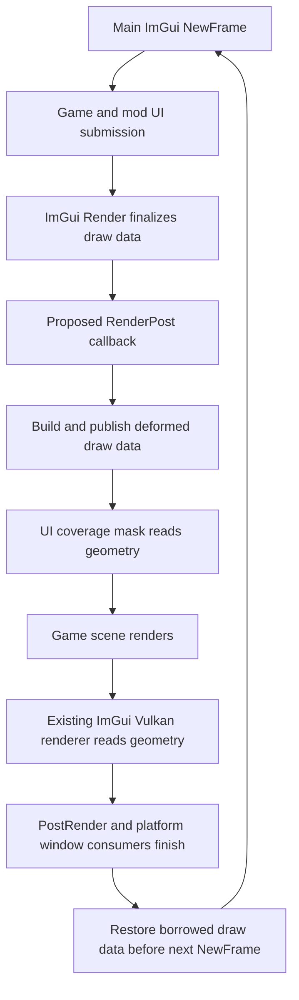

# Wobbly Windows implementation research

Research baseline: November 4, 2026. Target: Kitten Space Agency build **2026.10.25.5707**.

**A high-quality wobbly windows mod looks technically feasible. The strongest starting architecture is a CPU spring simulation plus deformation of live ImGui draw geometry, using the game's existing renderer.** A custom shader is optional. The difficult parts are clipping, draw-data ownership, and UI occlusion. Mouse hitboxes will remain unchanged: waiting for the release wobble to settle before targeting controls is an accepted interaction tradeoff.

The proposed first experiment should prove the integration on one ordinary window. The intended finished experience is a window that follows the exact grab point, bends smoothly during movement, settles naturally, keeps its contents live, and returns to normal mouse targeting when settled. This is a source-backed design, not an in-game feasibility demonstration: no mod has been implemented or run for this research.

## Evidence and compatibility baseline

Three research agents independently investigated the game pipeline, ImGenie and motion design, and loader/community-mod integration. The findings below combine their work with direct source inspection. Existing notes were checked against the newer local game snapshot.

| Material | Inspected baseline | Contribution |
| --- | --- | --- |
| KSA assemblies and BRUTAL bindings | `4b3e9e2281c6eec25c9ab77ddf2961ec53ec3dc8`, game `2026.10.25.5707` | Real rendering order, native layouts, window state, input, occlusion |
| StarMap | `20f01a29b18330ad54bf5d5835d702c0127dac0c` | Entry discovery, lifecycle, menu services, dependencies |
| ImGenie | `60b16e470043b8e8e8d7842fc9bd09abba7b3708` | Existing wobble, capture strategy, physics and limitations |
| unscience | `744d83b0c1eaa1aca8f3eb5b77fb64b540b4b5b0` | Entry/core separation, settings/UI patterns, hotkey protection |
| purrtty | `790a82b4cd3e5a31886adfdb19843bda72d0419f` | Dense live UI, input capture, offscreen rendering, secondary contexts |
| KSA coffer skill | corpus `c73508c`, game `2026.10.10.5554` | Lifecycle, rendering, ShaderExtensions and community implementation guides |
| Build and release KB | documented snapshot `2026.10.19.5638` | .NET 10, `.slnx`, dependency ownership, automatic Release staging |
| BRUTAL KB | placeholder index/log | No substantive rendering guidance; actual BRUTAL bindings supply the evidence |
| Project and idea notes | Current local notes | Scope is in-game ImGui 2D windows; shader was an initial hypothesis |
| Harmony, ImGui, ImGui design, mod implementation skills | Current workspace copies | Patterns and API guidance, corrected where actual source differs |

The local native `imgui.dll` is a Windows x64 binary with a `1.92.2` version string. Static PE export inspection confirms `AddContextHook_internal`, `RemoveContextHook_internal`, `GetVersion`, `GetCurrentContext`, and `DebugCheckVersionAndDataLayout`. These are stronger evidence than a generated binding alone, but still require a live callback test. Baseline SHA-256 values:

```text
imgui.dll        f9ba4a3be42035dda61f0f3df3b97632fd69627bef5d267641cd7a4d189bc331
Brutal.ImGui.dll 9fec93ddeda6b2127cd2bf1db115dbdef1e326b74c775e74917069c007b926f7
KSA.dll          a7acc114a016f0fb8c35a132be4ffdef61dcd69c8d0f7e132dd468b7532e006c
```

Use these as reproducibility fingerprints, not as proof that another installed build or platform is compatible. Reject an unknown internal layout before unsafe access. `DebugCheckVersionAndDataLayout` may assert on a mismatch and does not certify internal window/context layouts; it is not a safe substitute for a compatibility policy. The game version is recorded in [version.json][version].

## Why the renderer can support this

KSA's UI ends up as indexed textured triangles. The managed BRUTAL bindings expose the draw lists, vertex positions, UVs, colors, texture references, clip rectangles, and command offsets. They also expose `ImGuiContext.Windows`, `MovingWindow`, active IDs, and each window's draw-list and parent/root pointers. A mod can therefore associate visible geometry with a moving window without patching every game's or mod's `ImGui.Begin` call. [Context][context], [window fields][window], [draw list][drawlist], [vertex layout][vertex].

The current layout uses 20-byte `ImDrawVert` values and **16-bit indices**. The renderer supports command `VtxOffset`, so larger output must use properly segmented commands; switching a buffer to 32-bit indices is incompatible with this backend. Verify the runtime layout before dereferencing internal structures. [Vulkan backend][backend], [draw list][drawlist].

The relevant frame sequence is:



`Program.OnFrame` calls `ImGui.Render()` after the ordinary UI, menu/thread-safe UI, FPS, and console. Later, `RenderGame` first records the UI coverage mask and eventually draws ImGui. [Frame sequence][frame], [mask invocation][maskcall], [visible draw][visibledraw].

### The coverage mask is essential

`UiCoverageMaskSystem.RecordMaskGeneration` uploads and replays the ImGui draw data before rendering the world. This helps the game avoid drawing world pixels hidden by UI. If only the visible UI pass is warped, the game may still cull the original rectangular area, leaving incorrect pixels behind the bent window. **Both consumers must see the same geometry for the frame.** [Mask generation][mask].

There is a second path for explicit opaque rectangles. `GaugeCanvas` submits a custom draw callback and separately registers such coverage. Excluding custom-callback roots also excludes these gauges, so their rectangles remain consistent. Merely identifying something as an ImGui window is insufficient. [Gauge rendering][gauge], [mask replay][maskreplay].

The mask only trusts certain textures and skips callbacks. Keeping original texture references and alpha semantics allows the ordinary supported path to continue working; custom images must not be newly treated as opaque. A texture-based replacement would need separate coverage validation.

## Recommended integration

### Use an ImGui context hook

BRUTAL exposes `ImGui.Internal.AddContextHook` and `RemoveContextHook`, including `RenderPost`, `NewFramePre`, and shutdown hook types. In upstream `v1.92.2-docking`, `RenderPost` runs after the draw lists have been flattened and completed. `NewFramePre` occurs before the next frame invalidates draw data and processes input. [Local bindings][hooks], [callback ABI][hookcallback], [upstream render order](https://github.com/ocornut/imgui/blob/v1.92.2-docking/imgui.cpp#L5667).

Prefer these callbacks for per-frame work. Use a small managed Harmony patch only to attach/detach at the known game lifecycle point if necessary. The main static `KSA.ImGuiBackend.Initialize` is a useful identity boundary if the patch is installed before initialization. For late loading, attach at the next verified main `Program.PrepareImGui` boundary. Capture that context from the known game path, not whichever context happens to render first. [Backend initialization][backendinit], [main frame boundary][input].

Root the unmanaged callback delegate for its entire registration lifetime, match the Cdecl signature, and catch managed failures inside the callback. A try/catch cannot make invalid pointers safe: validate compatibility before access. Remove hooks before freeing callback state, restore any published draw data before freeing buffers, and coordinate shutdown with context destruction. Never remove or free resources in the middle of their callback.

If the native hook cannot be validated, a narrowly matched insertion immediately after `ImGui.Render` in `Program.OnFrame` is a fallback. It must verify its match and disable itself on an unexpected method body. Avoid depending on patching the tiny `ImGui.Render` wrapper or native extern methods: inlining and missing IL are established Harmony limitations. [Harmony edge cases](https://harmony.pardeike.net/v2/articles/patching-edgecases.html).

### Keep native window buffers untouched

The preferred ownership design is a transaction over final draw data:

1. At `RenderPost`, inspect the main context's final draw data and map list pointers to eligible roots.
2. Build replacement lists in reusable mod-owned buffers. Keep unmodified list pointers for everything else, at exactly their existing positions.
3. Fully validate the replacement before publishing it. On failure, retain original geometry for the affected root or entire frame.
4. Save the original `CmdLists` vector header, `CmdListsCount`, and vertex/index totals. Publish a mod-owned list-pointer vector and matching totals in the draw-data structure.
5. Leave that data valid for every consumer, including the mask, final renderer, and `PostRender` platform-window rendering. The first GPU upload does not end its lifetime.
6. Restore the original header and totals at `NewFramePre`, and through the coordinated disable/shutdown path, before reusing/freeing replacement storage.

Do not replace `window.DrawList`, mutate original vector ownership, or leave native write pointers referring to replacement buffers. ImGui draw lists also hold `_VtxWritePtr`, `_IdxWritePtr`, `_CmdHeader`, splitter state, and callback storage. Isolating the published view avoids corrupting those structures and avoids accumulating deformation when a window retains drawing. [Draw-data layout][drawdata], [draw-list layout][drawlist].

Saved `ImVector` headers are borrowed references, not newly owned collections. Never clear, free, or resize an original vector through its saved header: this wrapper's `Clear()` frees native storage and changing `Count` can allocate. Explicitly separate mod-owned storage from borrowed native state. [Vector implementation][imvector].

Track context generation, viewport, and frame number; never deform the same output twice. Support the main game viewport first. Unknown secondary viewports should remain untouched until tested. Do not cache a window pointer as durable identity: use a context generation plus ImGui ID, resolve current pointers each frame, and retire stale motion state.

### Preserve other ImGui contexts

purrtty's ordinary terminals use the game's UI, while its in-world panels use a second ImGui context with a shared font atlas and another instance of the same KSA backend type. Consequently a global patch on `Render` or `RenderDrawData` would also see those offscreen panels. The effect must apply only to the captured main context and its supported viewport. [purrtty context][purrcontext], [offscreen backend][purrbackend].

## Geometry correctness

Simply moving existing vertices is a useful smoke test, but it is insufficient for the finished effect. A window background can be a few large triangles, whereas text contains many small quads. Under a nonlinear warp, coarse geometry stays visibly straight unless subdivided. Keeping the old rectangular scissor cuts bent edges; expanding it alone exposes text or table content that should remain clipped.

For each supported draw command, use this proposed sequence:

1. Resolve source triangles using both `IdxOffset` and `VtxOffset`.
2. Clip each triangle against its **original command clip rectangle in logical UI coordinates**. Interpolate UVs and vertex colors at generated intersections.
3. Subdivide the remaining geometry sufficiently to represent the deformation. Preserve attributes along original edges and use a conforming subdivision scheme to avoid cracks or different curved approximations on shared edges.
4. Apply the root window's common deformation field to every resulting position, including its child windows.
5. Emit commands in the same order, with the same texture references and alpha meaning. Use a conservative scissor around the emitted geometry intersected with the viewport.
6. Split large output into command-local index ranges within the 16-bit limit. Recalculate command offsets and draw-data totals.

This preserves scroll clipping in the original UI before bending the visible surface. Adaptive subdivision should use a screen-space error target, with a strict work budget. Begin with a simpler deterministic subdivision for the prototype; add adaptation only after image comparisons establish correctness. Anti-alias fringes, translucent overlaps, narrow lines, and integer scissor rounding need visual tests. [Renderer conventions](https://github.com/ocornut/imgui/blob/master/docs/BACKENDS.md), [local renderer][backend].

If a root or any descendant contains an unsupported user callback, unknown shared list ownership, or an incompatible draw-data transformation from another mod, leave the entire root unchanged. Partial distortion creates seams and can break callback semantics. Known callback support can be added deliberately later.

Viewport boundaries require a conservative first policy. ImGui can discard offscreen widgets before final draw data exists, and original clipping can remove geometry that a warp would otherwise bring back onscreen. Reconstruction cannot recover omitted content. Start with fully onscreen roots or taper/clamp deformation at viewport edges until edge behavior is validated.

## Motion model

### What to take from ImGenie

ImGenie provides a useful reference for drag detection, root/child grouping, cursor anchoring, and bounded animation state. Its inspected wobble is a snapshot compositor: it captures the window at drag start, removes root and child draw lists, and draws a textured mesh through the foreground list. Its four independent corner springs drive a denser render mesh; mesh resolution is not the number of simulated particles. On release it uses an eased interpolation to the resting rectangle. [Capture and removal][igcapture], [springs and settle][igmotion], [mesh interpolation][igmesh].

For KSA this design has three significant drawbacks: captured contents stop visually updating, foreground composition changes stacking, and release does not continue spring momentum. There is also an anchoring inconsistency: the grab constraint uses bilinear weights while the displayed mesh uses a different curved interpolation. An adaptation should use identical basis functions for the visible surface and grab constraint.

ImGenie is MIT licensed. Preserve its license and attribution for any copied or adapted substantial code. Treat it as design/reference material; importing its native library and capture backend is unnecessary for the recommended C# approach. [License][iglicense].

### Proposed solver

Compiz's upstream wobble provides another useful model: a 4 by 4 control lattice, neighbor springs, a grab anchor, and a Bézier surface over separately subdivided render geometry. It also carries motion forward while force or velocity remains. This supports separating simulation detail from rendering detail. Its source carries a permissive Novell notice; retain the applicable notices if adapting code. [Compiz wobbly source](https://raw.githubusercontent.com/compiz-reloaded/compiz/master/plugins/wobbly.c).

Start by comparing a small connected spring lattice with the simpler four-corner model in an isolated harness. A **4 by 4 control lattice** with a smooth surface is a reasonable initial candidate for a richer effect; it is a design choice to tune, not a verified optimum. Keep the simulation grid independent from render tessellation.

Each control point has a logical UI-space position and velocity. Its rest position follows the native ImGui rectangle. Neighbor springs preserve the rectangle's shape, restoring forces bring the whole surface home, and damping dissipates energy. When native window position changes, preserve particle inertia instead of translating all simulated points instantly. The grab constraint pins the actual evaluated surface point under the cursor, using the same interpolation as rendering. Preserve and constrain velocity consistently so position correction does not create repeated energy spikes.

Use a fixed simulation step with an accumulator and bounded catch-up work. A candidate starting point is **1/120 second**, with up to eight substeps and an explicit reset/settle policy for longer stalls; these values need testing with the selected spring constants. Interpolate the rendered state if needed at high refresh rates, then reapply the exact grab constraint to the displayed surface so interpolation cannot introduce cursor lag. Use real UI time, independent of game pause and time warp.

Clamp displacement relative to window size, limit strain, detect inverted or nearly degenerate geometry, and fall back toward identity if the surface folds. Handle tiny windows, collapse, resize, docking changes, teleporting programmatic moves, close/reopen, focus loss, and a disappearing HUD as state transitions. Stop simulation after displacement and velocity stay below thresholds, then return to **exact original geometry**, including its original clipping and tessellation.

Expose a few understandable presets such as Subtle, Classic, and Playful, plus strength and settling controls. Raw spring constants and mesh diagnostics belong in an advanced section. The initial default should protect text readability.

These are useful initial tuning experiments, not calibrated defaults:

| Parameter | Initial experiment |
| --- | --- |
| Response frequency | 2.5–4 Hz with moderate damping |
| Maximum deformation | 4–8% of the smaller window dimension, plus a pixel cap |
| Sleep displacement | About 0.25 framebuffer pixel, with a low velocity threshold |
| Geometry approximation | About 0.25–0.5 framebuffer pixel error |
| Release behavior | Short natural settle, adjustable through damping/settling controls |

## Accepted mouse interaction scope

**Keep native mouse hitboxes and input routing unchanged. Natural release wobble is in scope; inverse mouse mapping is out of scope.** Waiting for the wobble to settle before accurately targeting controls is acceptable for this mod.

During native title-bar dragging, existing mouse capture and an exact grab anchor preserve the normal drag. During settling, widgets remain interactive at their original logical rectangles, so a displayed control may temporarily be offset from its click target. This design does not block clicks or promise accurate visual targeting during that interval. At rest, the effect must return to exact identity so targeting is fully normal again.

Keep the default settling period short and predictable, provide a settling control, and preserve an immediate disable/reduced-motion option. Do not snap on mouse-down and imply this fixes targeting: the user may have aimed at the preceding frame's displaced control. A brief help description can explain that controls line up once movement settles.

Avoid changing global `io.MousePos`: `Program.PrepareImGui` also sends that value to the game cursor. Ordinary input regression tests still matter, but accurate targeting during the release tail is not an acceptance gate. [Game cursor input][input], [purrtty input handling][purrinput].

If exact targeting during wobble is ever requested, treat it as a separate feature requiring the last displayed mesh, inverse mapping, frontmost-window selection, and correct capture across overlapping roots. It is unnecessary for this implementation.

## Window policy and user controls

Start with ordinary, movable top-level windows. Children inherit their root's deformation. Keep menus, popups, modals, tooltips, docking hosts/docked windows, fixed HUD overlays, custom-callback roots, global foreground/background lists, software cursors, and foreign contexts unchanged. Suspend a parent's effect for unsupported transient UI relationships rather than stretching only part of the interaction.

Use IDs and structural flags for policy, with a small explicit override/opt-out API for other mods. Titles alone are unreliable identifiers. Do not permanently move a window's logical position, modify its saved layout, or change the game's UI scale to achieve the effect.

Settings should include enable, reduced motion/off, presets, strength, settling, per-window exclusions, reset, and a live sample window. Show an understandable compatibility message when deformation is unavailable. Keep diagnostics such as vertices, processing time, active roots, and exclusion reasons behind an advanced panel. Use the existing ImGui layout patterns for aligned controls; avoid adding the entire unscience UI dependency just for padding helpers.

## Alternative rendering strategies

| Approach | Benefits | Costs and decision |
| --- | --- | --- |
| Live CPU geometry deformation | Live content; native textures and renderer; shared geometry for mask and UI; natural stacking | Clipping/tessellation and memory ownership must be correct. **Recommended first path.** |
| Fresh per-window texture capture every frame | Original clipping handled by offscreen rasterization; predictable regular warp mesh | Vulkan targets, synchronization, alpha/color-space handling, font updates, sampling quality, child grouping, and coverage-mask integration. Keep as fallback if CPU reconstruction is too expensive or fragile. |
| ImGenie-style one-time capture | Small conceptual prototype; existing effect to study | Frozen content and changed stacking are unsuitable defaults for KSA. |
| Custom vertex or fragment shader on the existing UI pass | Could move deformation work to GPU | Vertex shaders still need enough tessellation; rectangular clip handling remains; UI mask must match. A screen-level shader cannot reliably isolate overlapping windows. |

purrtty demonstrates a mod-owned Vulkan offscreen ImGui renderer, but its separately authored UI is not a ready-made arbitrary-window compositor. The coffer's ShaderExtensions analysis demonstrates per-window capture/replacement and also records callback omission and resource-lifetime pitfalls. Those patterns are useful fallback research, not code to copy wholesale. [purrtty offscreen context][purrcontext], [ShaderExtensions analysis][shaderex].

## Project and loader design

Use one installable mod with a thin `wobbly-windows` entry/UI assembly and reusable `wobbly-windows.lib` functionality. Keep the numeric solver and geometry operations independent of KSA where practical; isolate unsafe host bindings and context management behind a small adapter. Tests should exercise the reusable code without launching the game. Do not make a standalone mod depend on the entire unscience mod.

StarMap discovers `[StarMapMod]` and lifecycle-attributed methods. The mod itself invokes its own patch helpers. Initialize managed state at the appropriate load stage, bind native state only when the known main context exists, and tear down hooks, menu registrations, buffers, and owned patches through `[StarMapUnload]`. [Loader discovery][loader], [unscience entry][unscience].

Prefer `IModMenuService.AddModMenuItem` when selecting a loader version that provides it; retain its disposable registration. The game's public `DrawProgramMenusHook` is a compatibility alternative. Preserve text-input hotkey protection if the settings include text fields, without adopting terminal-wide keyboard capture. [Menu service][menu], [purrtty input handling][purrinput].

The build should target .NET 10 and an XML `.slnx`. A plain Release build must automatically produce the complete installable mod directory using MSBuild and an explicit payload allowlist. Ship owned entry/core DLLs, needed metadata/content, and license notices. Do not bundle KSA, BRUTAL, Planet, StarMap, host Harmony, or a replacement native ImGui library. Native platform support requires actual testing. [Build contract][buildkb].

### Corrections to reference guidance

- The Harmony skill's description of StarMap calling `Patcher.Patch`/`Unload` by name is contradicted by the loader and current mods.
- `StarMapAfterGui` is a postfix on `OnDrawUiViewports`; more UI is submitted afterward. It is not a final-geometry hook. GUI hooks also disappear while the HUD is hidden.
- Current StarMap source resolves `OnFrame` without non-public binding flags while the current game declares it protected. Treat `StarMapAfterOnFrame` as needing installed-version verification; the proposed context-hook design does not depend on it.
- Parameterless immediate-load methods in older examples do not match the inspected loader's required `KSA.Mod` parameter.
- The mod implementation skill's `ksa-mod-experiments.slnx` and template-folder paths describe another repository. Preserve its reusable-core intent without inventing that monorepo here.
- The release KB index requires automatic Release staging; an older opt-in staging example in its dependency reference conflicts with that contract. Follow the explicit index requirement.

## Implementation milestones and acceptance gates

| Milestone | Deliverable | Evidence needed before advancing |
| --- | --- | --- |
| 1. Compatibility and callback probe | Tiny diagnostic mod; no wobble | Main-context identity; installed game/loader versions; safe compatibility checks; callback timing; visually identical identity substitution/restoration; clean unload; unchanged secondary context |
| 2. Single-window deformation | One allowlisted sample window during title-bar drag | Exact grab point, original z-order, live changing contents, same shape in coverage mask and visible draw, no artifacts after disable |
| 3. Geometry reconstruction | Clipped/tessellated output and child support | Scroll/table clips, glyphs/images, anti-aliasing, translucent content, 16-bit segmentation, zero partial publication, source buffers unchanged |
| 4. Motion quality | Stable lattice and presets | Repeatable response across frame rates, bounded stall behavior, no folding, exact sleep/identity, resize/close/focus transitions |
| 5. Release behavior and native input | Natural settling with unchanged mouse hitboxes | Predictable short settle; exact targeting restored at rest; native drag/capture, wheel/text/selection, and game cursor unaffected; explain temporary visual targeting offset |
| 6. Compatibility and performance | Supported-window policy, failure fallback, profiling | Editor/flight/map, HUD hidden, pause/warp, DPI/resize, purrtty 2D and in-world, other draw-data effects, tested allocation and latency budgets |
| 7. Distribution | Installable Release output and release notes | Fresh build, dependency/license allowlist, ZIP layout, actual game acceptance on each claimed platform |

For the first milestone, log the observed ordering and run the coverage-mask debug view. Prove a small, controlled geometry displacement reaches both consumers before spending time tuning a full spring lattice.

### Tests that matter

Geometry tests should cover identity, clip-boundary intersections, UV/color interpolation, shared edges, nonzero command offsets, output above 65K vertices, finite positions, bounds, and failure rollback. Use golden images for nested scroll regions, table columns, thin lines, curved borders, live terminals, transparency, overlap, and varying DPI. An identity image comparison is especially valuable before testing a nonlinear warp.

Solver tests should replay identical mouse paths at 30, 60, 120, 144, and 240 Hz with stalls; check grab error, bounded displacement, energy decay after release, no inverted geometry, and exact final identity. Test near-corner grabs and abrupt reversals. Mathematical comparisons must distinguish simulation error from render interpolation error.

Input acceptance should verify normal clicks, wheel/selection, overlapping windows, popup creation, and game controls after settling, plus unchanged native behavior during wobble. Observe immediate clicks during the release tail to confirm the documented targeting limitation; do not build inverse mapping to eliminate that accepted tradeoff. Record frame time separately for physics, geometry processing, allocation, GPU upload, and coverage-mask work. Avoid a universal performance promise before measuring on representative hardware. The inactive path should return original draw data and avoid geometry rebuilding or per-frame allocation.

### Decision

Proceed with the compatibility probe and a single-window live-geometry prototype. The local code provides a credible path with no replacement renderer or mandatory custom shader. Keep CPU clipping/tessellation and shared mask geometry as explicit gates; those will determine whether the production implementation stays with live geometry or needs a more involved compositor. Preserve ordinary input and accept the short visual targeting offset during release settling.

## Source locations

Local links below point to the inspected snapshots. Commit identifiers above provide the reproducibility boundary.

[version]: /Users/asherwin/wip/wobbly-windows/repos/ksa-game-assemblies/current/version.json:2
[context]: /Users/asherwin/wip/wobbly-windows/repos/ksa-game-assemblies/current/decomp/Brutal.ImGuiApi/ImGuiContext.cs:106
[window]: /Users/asherwin/wip/wobbly-windows/repos/ksa-game-assemblies/current/decomp/Brutal.ImGuiApi.Internal/ImGuiWindow.cs:306
[drawlist]: /Users/asherwin/wip/wobbly-windows/repos/ksa-game-assemblies/current/decomp/Brutal.ImGuiApi/ImDrawList.cs:8
[imvector]: /Users/asherwin/wip/wobbly-windows/repos/ksa-game-assemblies/current/decomp/Brutal.ImGuiApi/ImVector.cs:19
[drawdata]: /Users/asherwin/wip/wobbly-windows/repos/ksa-game-assemblies/current/decomp/Brutal.ImGuiApi/ImDrawData.cs:8
[vertex]: /Users/asherwin/wip/wobbly-windows/repos/ksa-game-assemblies/current/decomp/Brutal.ImGuiApi/ImDrawVert.cs:6
[backend]: /Users/asherwin/wip/wobbly-windows/repos/ksa-game-assemblies/current/decomp/KSA/ImGuiBackendVulkanImpl.cs:650
[frame]: /Users/asherwin/wip/wobbly-windows/repos/ksa-game-assemblies/current/decomp/KSA/Program.cs:2443
[maskcall]: /Users/asherwin/wip/wobbly-windows/repos/ksa-game-assemblies/current/decomp/KSA/Program.cs:4972
[visibledraw]: /Users/asherwin/wip/wobbly-windows/repos/ksa-game-assemblies/current/decomp/KSA/Program.cs:5265
[mask]: /Users/asherwin/wip/wobbly-windows/repos/ksa-game-assemblies/current/decomp/KSA/UiCoverageMaskSystem.cs:460
[maskreplay]: /Users/asherwin/wip/wobbly-windows/repos/ksa-game-assemblies/current/decomp/KSA/UiCoverageMaskSystem.cs:637
[gauge]: /Users/asherwin/wip/wobbly-windows/repos/ksa-game-assemblies/current/decomp/KSA/GaugeCanvas.cs:803
[hooks]: /Users/asherwin/wip/wobbly-windows/repos/ksa-game-assemblies/current/decomp/Brutal.ImGuiApi/ImGui.cs:351
[hookcallback]: /Users/asherwin/wip/wobbly-windows/repos/ksa-game-assemblies/current/decomp/Brutal.ImGuiApi.Internal/ImGuiContextHookCallback.cs:5
[backendinit]: /Users/asherwin/wip/wobbly-windows/repos/ksa-game-assemblies/current/decomp/KSA/ImGuiBackend.cs:25
[purrcontext]: /Users/asherwin/wip/wobbly-windows/repos/purrtty/purrTTY.GameMod/InWorld/OffscreenImGuiContext.cs:43
[purrbackend]: /Users/asherwin/wip/wobbly-windows/repos/purrtty/purrTTY.GameMod/InWorld/OffscreenImGuiBackend.cs:69
[igcapture]: /Users/asherwin/wip/wobbly-windows/repos/imgenie-remote/ImGenie.cpp:1434
[igmotion]: /Users/asherwin/wip/wobbly-windows/repos/imgenie-remote/ImGenie.cpp:1160
[igmesh]: /Users/asherwin/wip/wobbly-windows/repos/imgenie-remote/ImGenie.cpp:135
[iglicense]: /Users/asherwin/wip/wobbly-windows/repos/imgenie-remote/LICENSE:1
[input]: /Users/asherwin/wip/wobbly-windows/repos/ksa-game-assemblies/current/decomp/KSA/Program.cs:2338
[purrinput]: /Users/asherwin/wip/wobbly-windows/repos/purrtty/purrTTY.GameMod/Patcher.cs:135
[shaderex]: /Users/asherwin/wip/wobbly-windows/.agents/skills/ksa-coffer/references/mods/shaderextensions/features/imgui-window-post-shader.md:65
[loader]: /Users/asherwin/wip/wobbly-windows/repos/starmap/StarMap.Core/ModRepository/RuntimeMod.cs:130
[unscience]: /Users/asherwin/wip/wobbly-windows/repos/unscience/unscience/Mod.cs:126
[menu]: /Users/asherwin/wip/wobbly-windows/repos/starmap/StarMap.API/Services/IModMenuService.cs:3
[buildkb]: /Users/asherwin/wip/wobbly-windows/kb/ksa-modding/index.md:22
